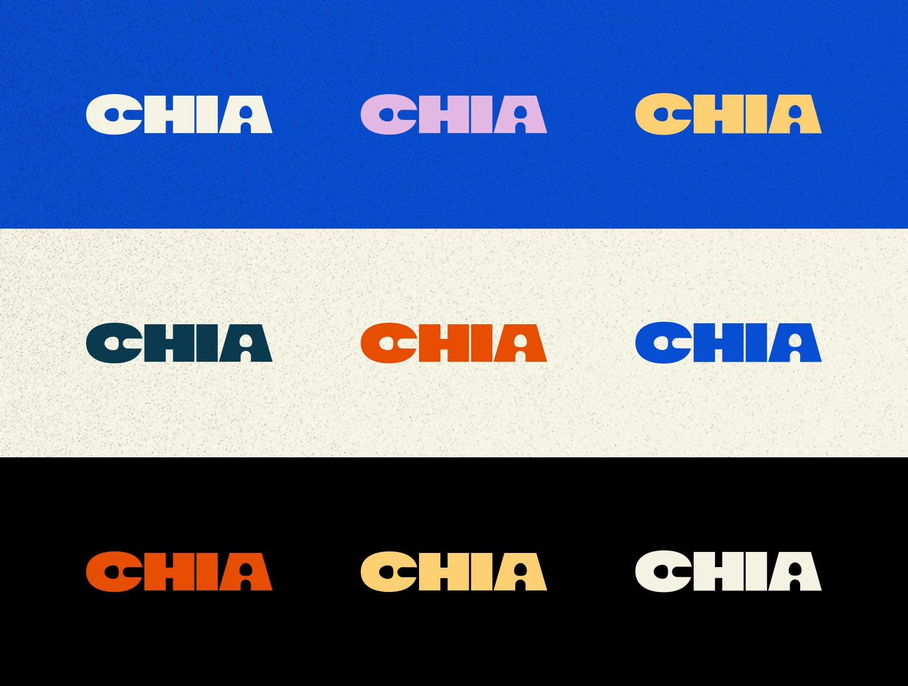
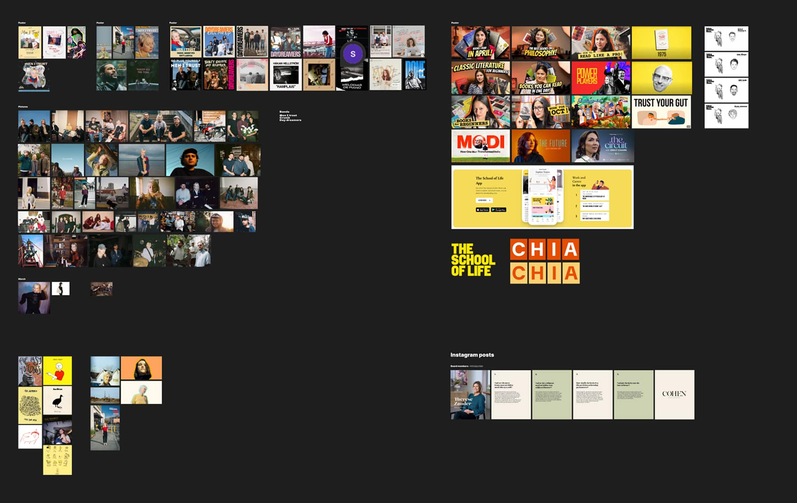
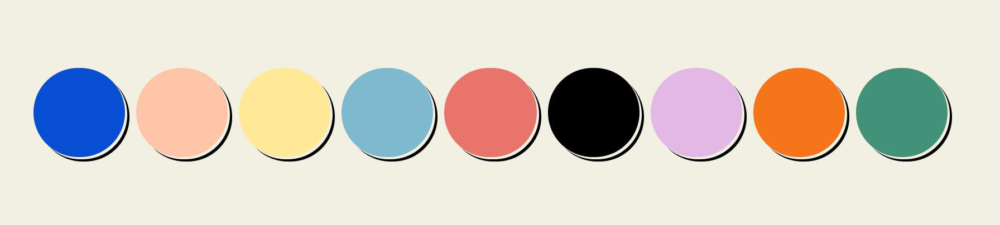
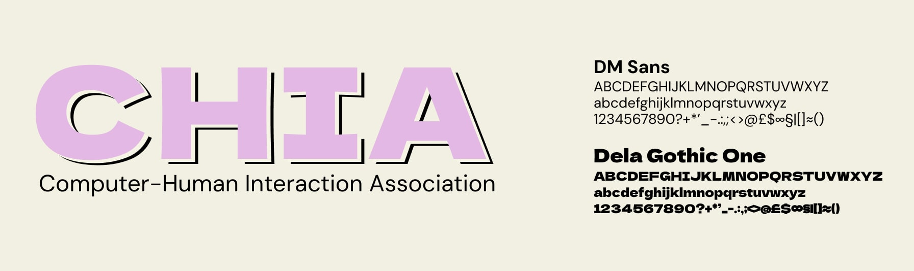
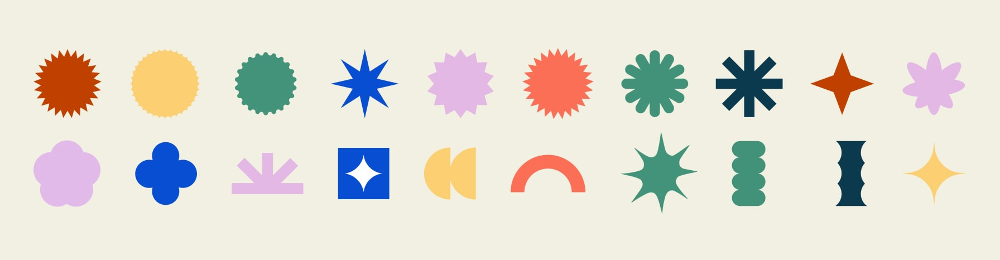
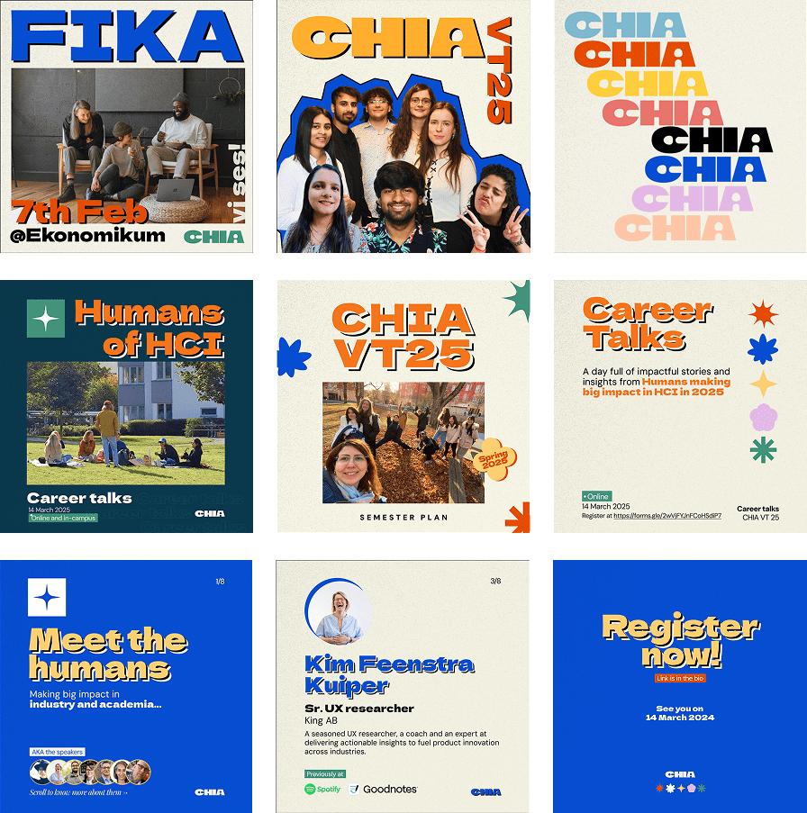

## Overview
CHIA (computer-human interaction association) is a student run association by the program Human-Computer Interaction offer by Uppsala University.
During the months January till June 2025 I have had the great pleasure of collaborating with the association on various different levels. 
During this time I helped the association with various activities such as organizing events, branding, social media and more. 
This article briefly describes the intent and philosophy behind creating the brand identity for CHIA.

## Branding

The brand identity for CHIA was meant to reflect the nature of Human-Computer Interaction as a discipline. 
In one of my lectures Prof. Annika Waern of Uppsala University famously said, “we HCI researchers are known to be quiet eclectic.” 
Thus the association by the program should capture that essence. The essence of the word “eclectic.” 
The word eclectic has been our north star during the design process.

We started with rebranding the logo. Kartiki Saraf, a collaborator on the project pitched the logo. 
She said the CHIA resounds with chia seeds. Chia seeds often used in chia pudding imbibe a sense of coziness to the association. 
Therefore, a logotype that captures the image of Chia seeds with a sense of coziness was born.

### Logotype 

## Design Language

As I mention above in the article, our approach with designing this brand identity was for it to reflect values that HCI and CHIA stood for.
HCI being the eclectic discipline that it is, and CHIA being the student association it is, aiming to standup for values such as Fun, Inclusivity, Sustainable and Approachable
yet Professional in its own right. 

Given the constraints we had with the time students could allocate to designing for CHIA, 
we chose an art style that was easy to put together, yet is effective in commanding the viewers attention none-the-less. 
Our mood board reflects the direction we used to realize the visual  identity for CHIA.
### Moodboard

### Colors

### Fonts

### Assets

## Social media
