## Overview
Cowrite's writing platform enables users to effortlessly craft resumes, 
job applications, job ads, and LinkedIn summaries in just minutes, streamlining the writing process and 
enhancing our customers' writing efficiency by an impressive 45%.

## Project Details

During my time as a UX consultant from October 2021 to March 2023, I was responsible for various roles including 
UX design, UI design, and frontend development. To effectively carry out these responsibilities, 
I utilized tools such as Figma, Vue.js, Javascript, and Tailwind.css and other UX methods.

## Users

Cowrite as a platform was designed with a mission to empower job seekers in their journey to success. From a business 
perspective Cowrite aimed at reaching out to the customers of recruiting agencies. The recruiting agencies were showcased in
picture below. 

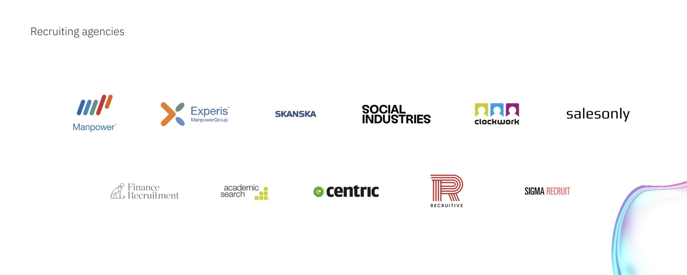

Understanding the business model of Cowrite understanding the core target audience became simpler. We (me along with the founders and the engineering team) 
divided the core audience into four personas.  Emily, a spirited 22-year-old recent graduate, eager to step into the professional world. 
James, a seasoned 36-year-old mid-career professional, looking to elevate his career. Linda, a bold 40-year-old career 
changer, ready to embrace new challenges, and Sarah, a determined 32-year-old returnee to the workforce, keen to 
make her mark once again. After several discussions and brianstorming sessions, we came up with the following personas.

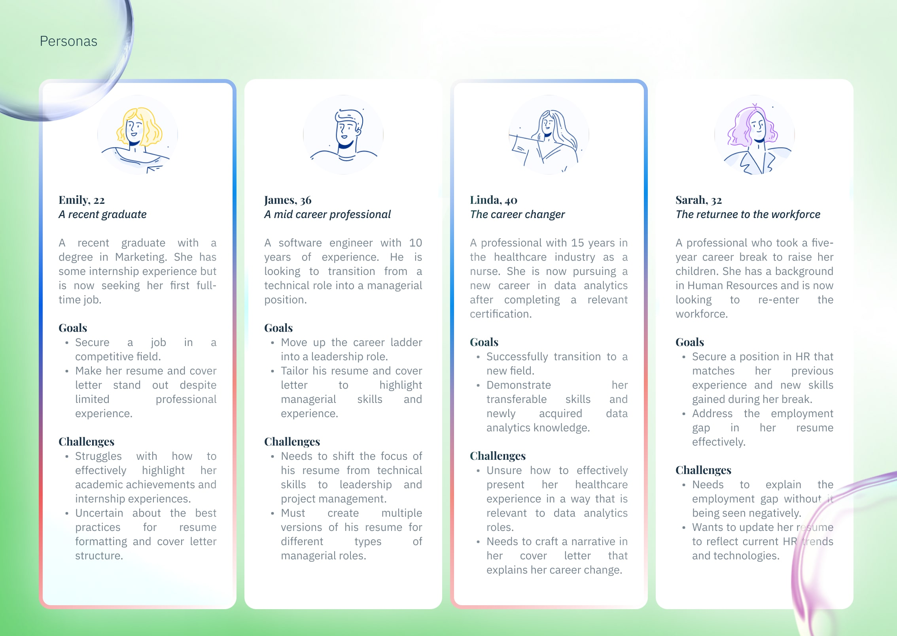

## Problems

Upon analyzing the users discussed above and gaining a deeper understanding of their challenges, 
we identified four key issues that the Cowrite platform could effectively address. 
First, many users struggle with the quality and professionalism of their writing, 
which can hinder their chances of success in job applications. Additionally, writers often experience writer's block, 
making it difficult to begin or complete their documents. Consistency across various application materials is another challenge, 
as users need to ensure that their resumes, cover letters, and other documents present a cohesive narrative. Finally, 
time efficiency emerged as a significant concern, as job seekers are often pressed for time and require a streamlined 
process to create their application materials quickly and effectively.

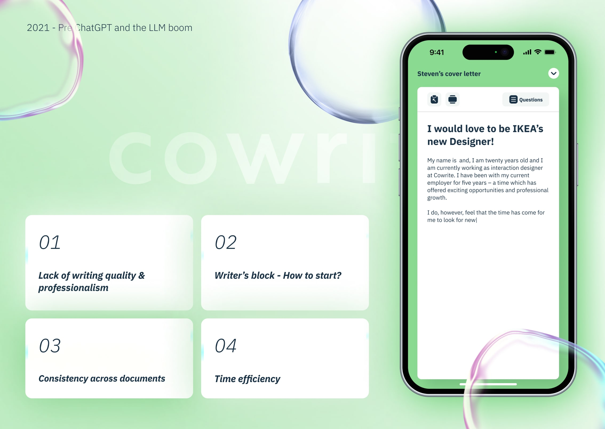

## Design Process
### Information Architecture
The information architecture of Cowrite is meticulously designed to ensure a seamless user experience for job seekers. 
At its core, the architecture organizes content in a way that allows users to navigate effortlessly through the various features of the platform. 

The primary focus is on clarity and accessibility, enabling users to find the tools they need without unnecessary complexity. 
The architecture is structured around key user journeys, such as creating resumes, cover letters, and job applications. 
Each section is intuitively labeled, guiding users through the process step-by-step.

To enhance usability, we implemented a hierarchical structure that categorizes information logically. 
For instance, users can easily access templates, pre-written content, and feedback tools, 
all of which are grouped under relevant headings. This not only streamlines the writing process but also 
reduces cognitive load, allowing users to concentrate on crafting their applications.

Moreover, the information architecture incorporates responsive design principles, ensuring that the layout adapts seamlessly across devices. 
This flexibility is crucial for users who may switch between desktop and mobile interfaces, providing a consistent experience regardless of the platform.

In summary, the information architecture of Cowrite serves as the backbone of the application, 
facilitating a user-friendly environment that empowers job seekers to create compelling application materials with confidence and ease.

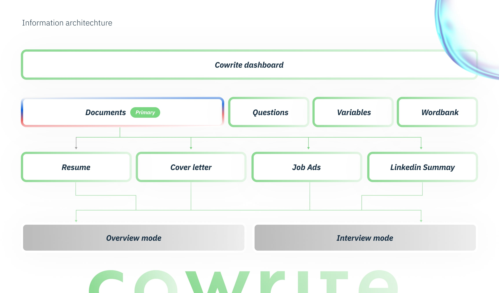

### Wireframes
A critical step of the design process is visualizing the structure and layout of a webapp before moving into more detailed design work.
Wireframes serve as a blueprint, allowing us to outline the essential components and functionalities of the application without the distraction 
of visual design elements. By creating these low-fidelity representations, we can focus on the user experience and the logical flow of interactions. 

During this phase, we explored various layouts and navigational structures, ensuring that each element serves a purpose and contributes to a seamless user journey.
This iterative process involved sketching multiple versions of the wireframes, gathering feedback from team members, and refining our designs based on usability principles. 

Ultimately, the wireframes provided a clear roadmap for the subsequent prototyping phase, enabling us to translate our ideas 
into interactive models that could be tested and validated with real users. 

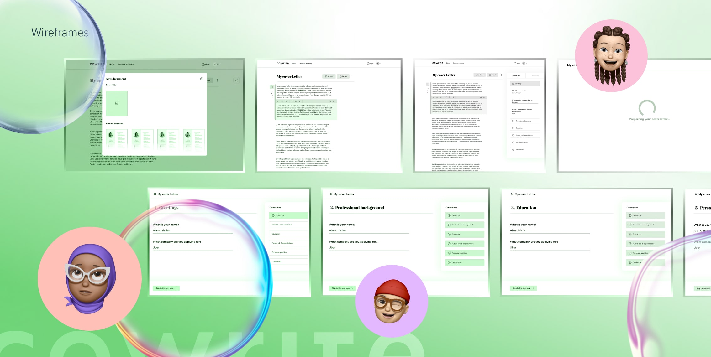

## Prototype Development

### Design System
The design system for Cowrite is a comprehensive framework that establishes a cohesive visual and functional language across the platform. 
It begins with a carefully curated color palette that reflects the brand's identity, utilizing shades that evoke professionalism and creativity. 
The typography is selected to ensure readability and accessibility, featuring a combination of modern sans-serif fonts that enhance the user experience.

For the web components, we drew inspiration from established design systems such as Material Design, Human Interface Guidelines, and Carbon by IBM. 
These frameworks provided us with best practices in layout, spacing, and interactive elements, which we adapted to fit the unique needs of Cowrite. 
By integrating these principles, we ensured that our components are not only visually appealing but also intuitive and user-friendly, 
ultimately enhancing the overall user experience.

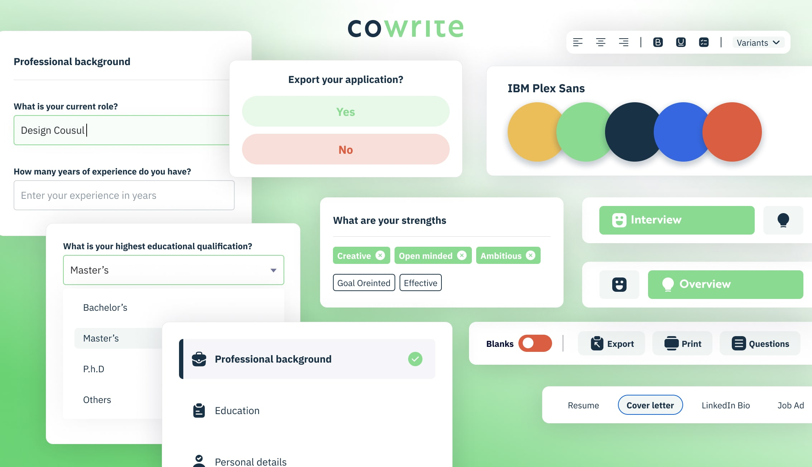

## Features
### Cover Letter Builder
The cover letter builder is designed with the primary goal of assisting job seekers in swiftly crafting professional and personalized cover letters.
This intuitive tool provides a range of features, including customizable templates that allow users to tailor their letters to specific job applications.
Additionally, it offers pre-written content to inspire and guide users in their writing process. To further enhance the quality of the letters, 
the builder includes real-time feedback on grammar and tone, ensuring that every detail is polished. 
Finally, users can easily download and share their completed cover letters, making the application process seamless and efficient.

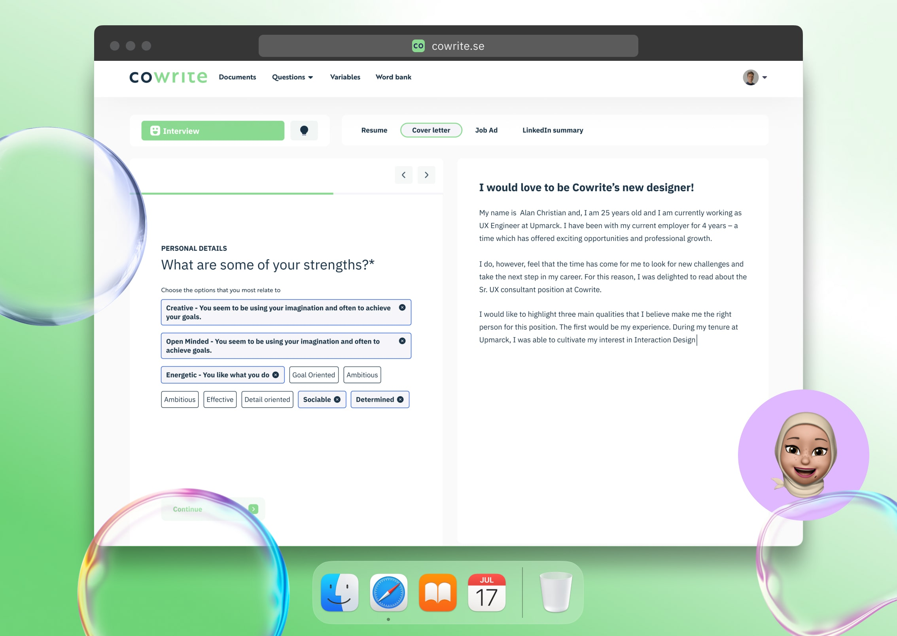

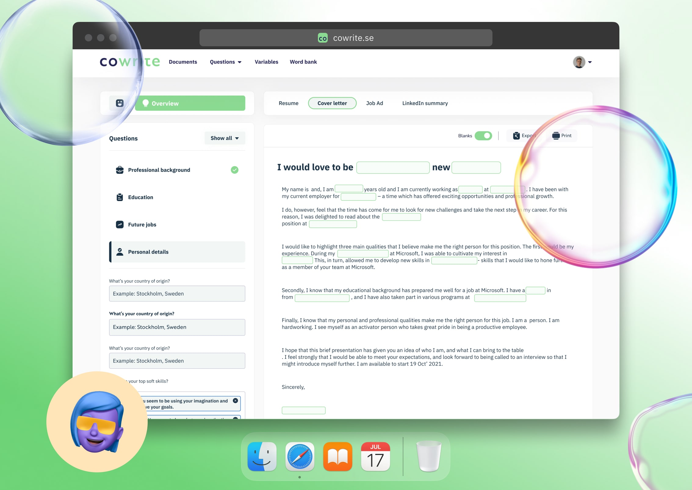

### Resume Builder
The resume builder is an invaluable tool for job seekers, designed to streamline the process of crafting professional and tailored resumes. 
With a variety of customizable templates, users can easily select a layout that best represents their personal brand and aligns with the 
job they are applying for. Additionally, the inclusion of pre-written content serves as a helpful guide, providing inspiration and 
ensuring that key information is effectively communicated. To further enhance the user experience, the builder offers real-time feedback on formatting, 
allowing users to make adjustments on the fly and ensuring their resumes meet industry standards. Finally, the ease of export and sharing options 
simplifies the application process, enabling users to quickly send their polished resumes to potential employers with confidence and efficiency.

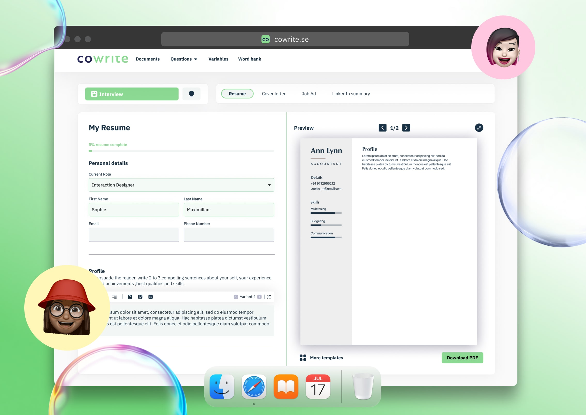

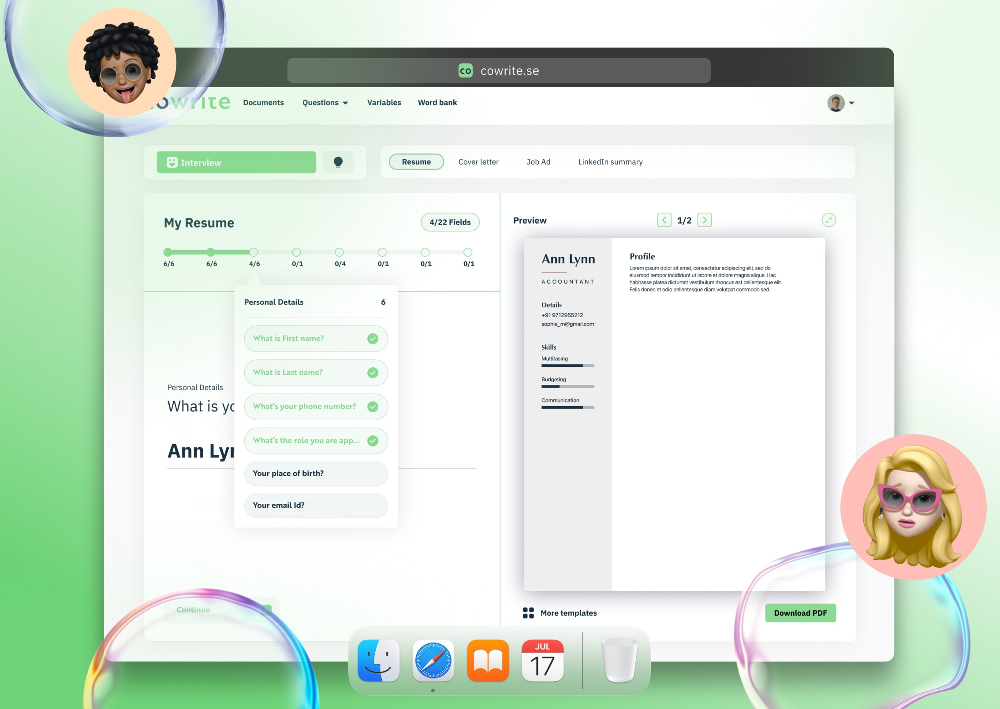

### Mobile View
The clients requested mobile compatibility for the app. Here are some of the key screens from the mobile interface.

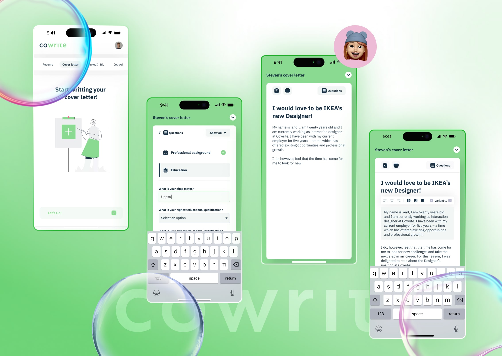

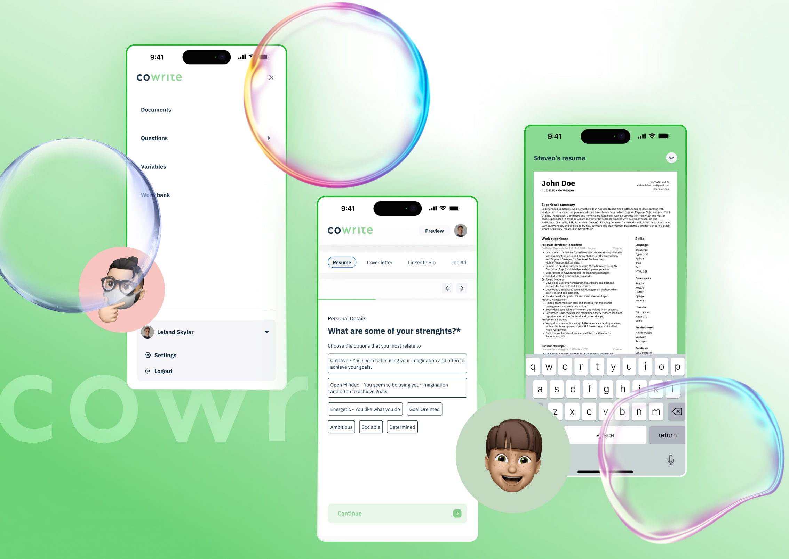

## Conclusion

The Cowrite platform has been a successful project that has helped job seekers create professional and personalized application 
materials with confidence and ease. The design process involved a comprehensive approach to user research, information architecture, 
wireframing, and prototyping, resulting in a user-friendly and efficient platform that has received positive feedback from users. 
We invite you to visit [Cowrite](https://www.cowrite.com) and experience the benefits of our tools for yourself!

