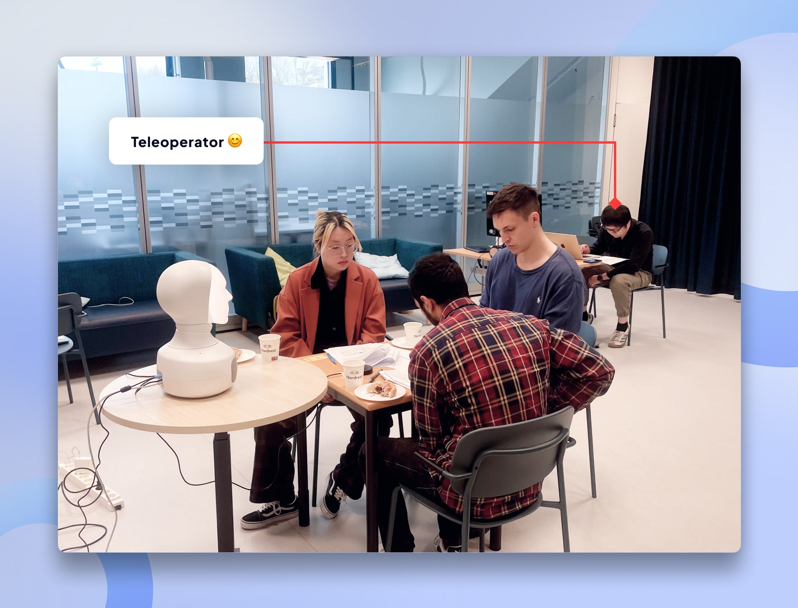
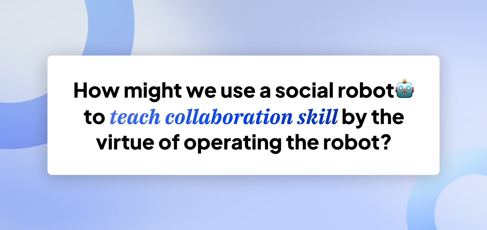
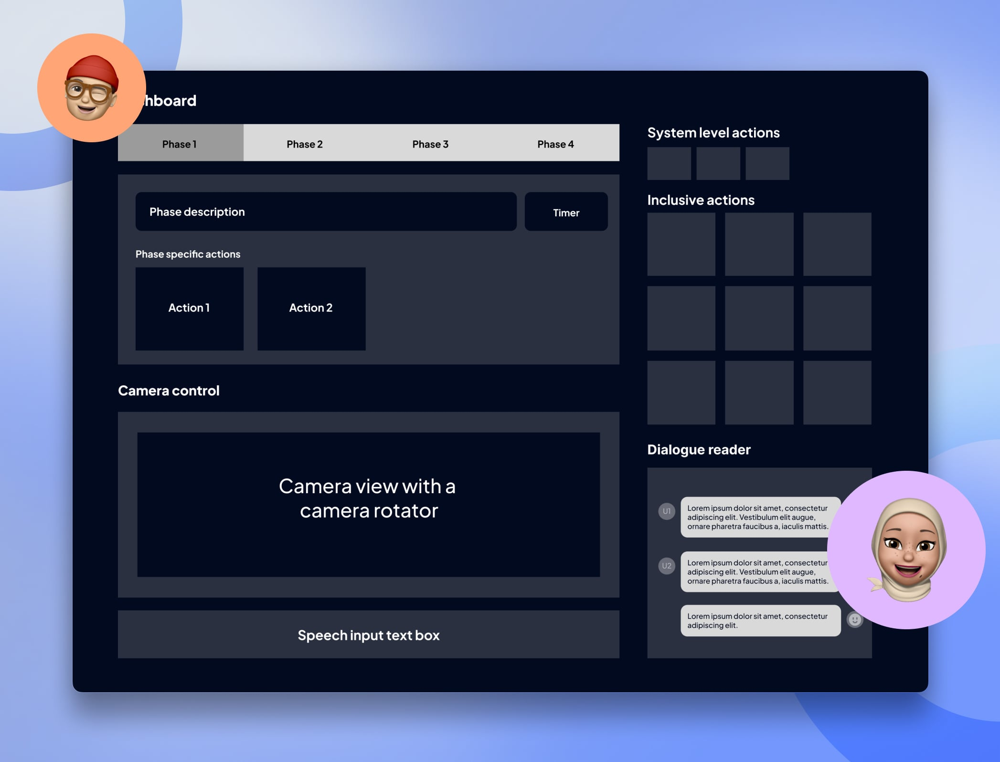
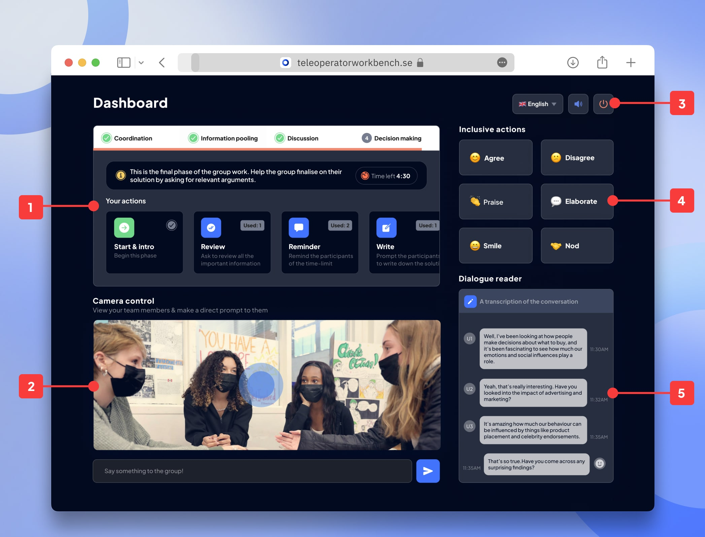
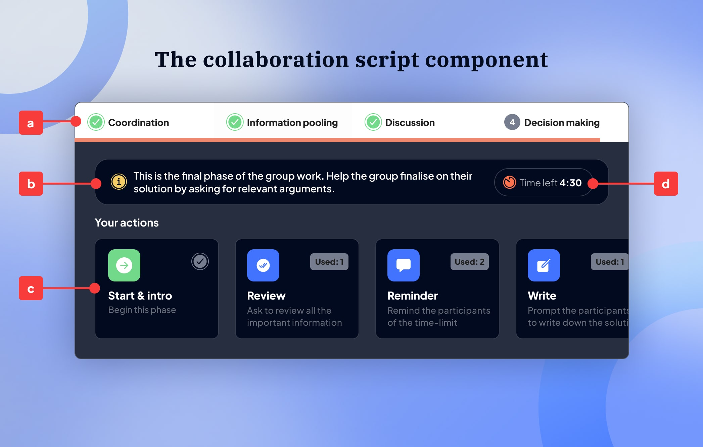
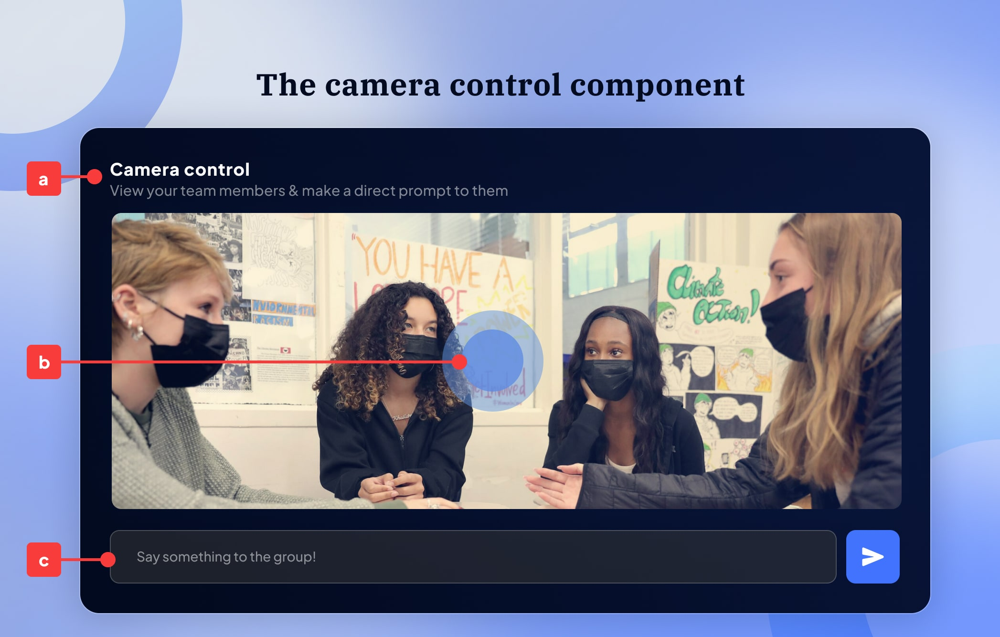
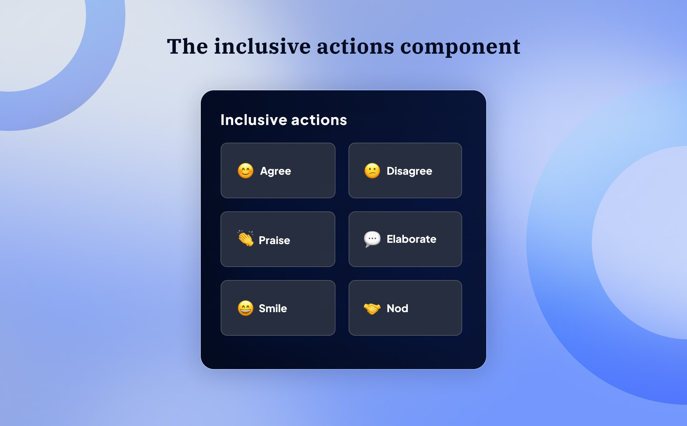
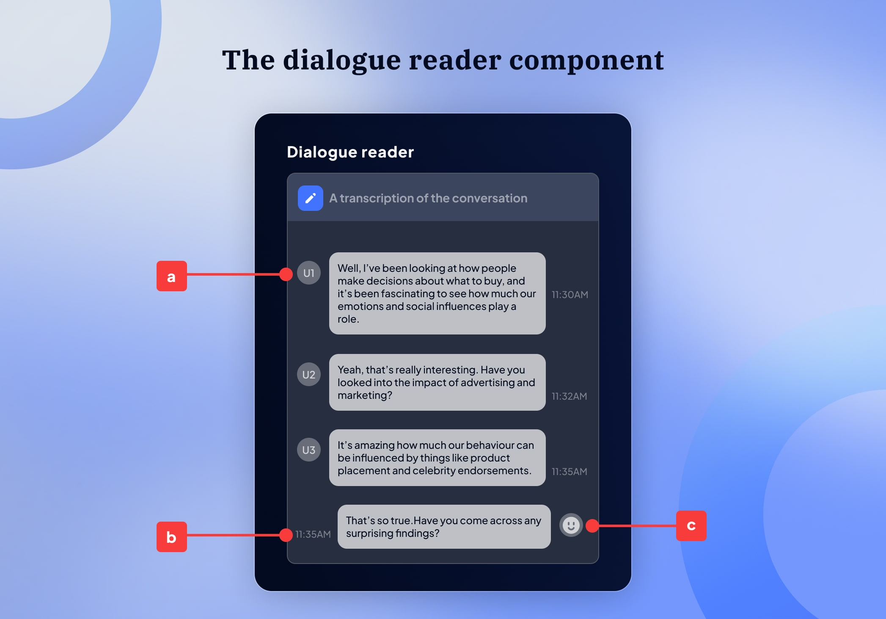
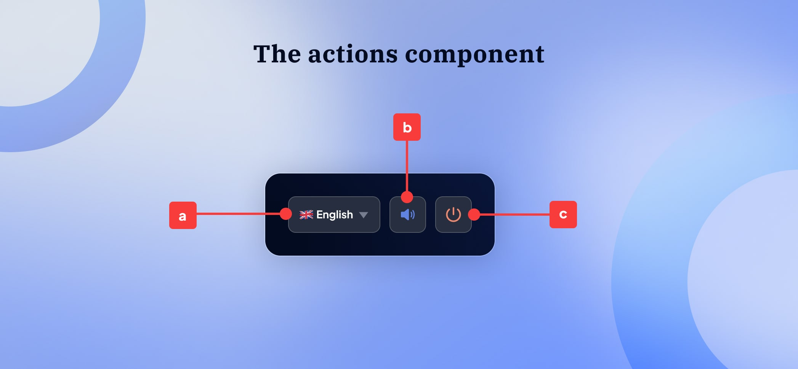

## Overview

This is an iteration of the work that me and my colleague Hong Wang did for our thesis. The dashboard that I present in this assignment is an iteration of the dashboard used by a teleoperator for the teleoperation of the robot, which is primarily Hong Wang's side of the project. The robot used in this context is the Furhat Robot and for our thesis, we aimed to build a robot group facilitator.

## Usecase

For our thesis, we aimed to develop a social robot that facilitates an inclusive collaborative experience for a group of three university students during their group work. To address this challenge, we explored two approaches to developing the robot systems: a fully autonomous system and a teleoperated system, where the robot is operated by a human user. This document presents the design proposal for a dashboard that the teleoperator can use to control the robot. The dashboard is designed for use in a web browser and is compatible with laptops (preferably 14, 15, or 16 inches), tablets, and desktops.

## Role of the teleoperator

In this use case, the teleoperator plays a crucial role in fostering inclusion and collaboration among the group members, ultimately guiding them towards a cohesive and collaborative experience during their interactions.

## Problem Statement

The central problem we are addressing is the challenge of teaching collaboration skills in a group setting, particularly among university students who may struggle with effective teamwork. In an increasingly digital world, where remote collaboration is becoming the norm, there is a pressing need to find innovative ways to enhance interpersonal skills and group dynamics. Our inquiry focuses on how a social robot can serve as a facilitator in this learning process. By operating the robot, students can engage in a unique interactive experience that not only teaches them the mechanics of collaboration but also encourages them to practice these skills in real-time. This approach aims to bridge the gap between theoretical knowledge of collaboration and practical application, ultimately fostering a more inclusive and effective group work environment.

## Design Methodology

Teleoperator's workbench is a speculative design case study, where through this project we have tried to develop a dashboard for users that intend to develop their collaboration skills by participating in a collaborative learning scenario. This case study is purely research-focused and follows the research-through-design methodology to discover new knowledge.

## Design Process
### Wireframe Creation

The wireframe creation process for the Furhat teleoperator dashboard was a pivotal step in translating our conceptual ideas into a tangible interface. We began by sketching low-fidelity wireframes that outlined the essential components and layout of the dashboard. This initial phase allowed us to focus on the user experience without the distraction of visual design elements.

We aimed to create a clean and intuitive interface that would facilitate seamless interaction between the teleoperator and the Furhat robot. The wireframes included key sections such as the main interface, collaboration script, camera controls, and system actions. Each component was designed with the user in mind, ensuring that essential functions were easily accessible and logically organized.

Through iterative feedback sessions, we refined our wireframes, incorporating insights from potential users and stakeholders. This collaborative approach helped us identify areas for improvement and ensured that the final design would meet the needs of teleoperators effectively. The wireframes served as a blueprint for the subsequent prototyping phase, guiding our development process and aligning the team on our shared vision for the dashboard.

Ultimately, the wireframe creation process was instrumental in establishing a user-centered design that prioritizes functionality and ease of use, setting the stage for a successful implementation of the Furhat teleoperator dashboard.

## Dashboard Components

### Main Interface

### Collaboration Script
The collaboration script component is designed to provide a structured framework for discussions, guiding participants through four distinct phases: first, **Coordination**, where the group aligns on objectives; next, **Information Pooling**, which encourages sharing of ideas and resources; followed by **Discussion**, where participants engage in dialogue to explore these ideas; and finally, **Decision Making**, where the group comes to a consensus on the best course of action.

### Camera Control
The camera adjuster component is designed to enhance the teleoperator's experience by providing a real-time video feed of the group, allowing for seamless monitoring of interactions. Additionally, it features a digital camera angle rotator, enabling the teleoperator to adjust the camera's perspective effortlessly. To further assist in communication, a textbox for speech prompts is included, facilitating smooth dialogue management during the session.

### Inclusive Actions
To promote inclusion and cultivate positive group dynamics, we have identified six essential actions that serve as the foundation for effective collaboration. These actions are designed to create an environment where every participant feels valued and empowered to contribute, ultimately enhancing the overall group experience.

### Dialogue Reader
The dialogue reader feature provides real-time transcription of conversations, complete with timestamp tracking to ensure accurate timing of each interaction. Additionally, it includes dialog bubbles that indicate when the robot intervenes in the discussion, enhancing the overall communication experience.

### System Controls
The system encompasses several essential actions that enhance user control and experience. Users can easily adjust language settings to accommodate diverse participants, ensuring effective communication. Additionally, sound intensity control allows for the customization of audio levels, creating an optimal listening environment. Finally, the system includes straightforward options for shutting down, providing a seamless end to the session when needed.

## Conclusion

The teleoperator's workbench is a dashboard that the teleoperator could use to control the robot. This dashboard is intended to be used on the web browser and it is compatible with laptops (preferably 14, 15, 16 inches), tablets, and desktops.

